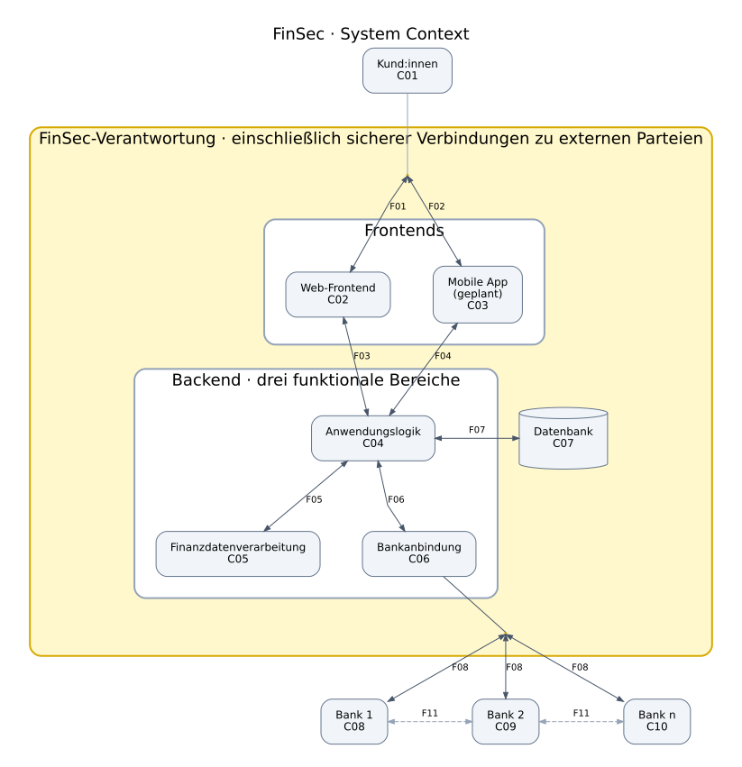

# FinSec – System Context

Der gelbe Rahmen umfasst FinSec und die von FinSec abzusichernden Teile der Anschlusswege. Kundengeräte und Banken bleiben extern. Die drei Backend-Bereiche sind funktionale Bereiche, keine Deployment-Stufen.

## Komponenten (1.1)

| ID | Komponente | Kurzbeschreibung | Verantwortung |
| --- | --- | --- | --- | 
| C01 | Kund:innen | Nutzen FinSec zur Verwaltung ihrer verbundenen Bankkonten. | Extern: Geräte und eigenes Verhalten liegen außerhalb von FinSec; FinSec verantwortet sichere Authentisierung, Sitzungen und Datenübertragung. | 
| C02 | Web-Frontend | Bietet die browserbasierte Oberfläche mit eingeschränktem Funktionsumfang. | FinSec verantwortet die Webanwendung und ihre sichere Kommunikation; der genaue Funktionsumfang ist noch offen. |
| C03 | Mobile App (geplant) | Bietet auf dem persönlichen Mobilgerät den vollen geplanten Funktionsumfang. | FinSec verantwortet App-Code, lokale Datenverarbeitung und Kommunikation; Betriebssystem und Gerät liegen außerhalb seiner Kontrolle. Plattform und Realisierungstermin sind offen. |
| C04 | Anwendungslogik | Steuert Anwendungsfälle einschließlich Nutzer- und Zugriffsverwaltung. | FinSec verantwortet Autorisierung, Sitzungsprüfung, fachliche Regeln und die sichere Koordination der Backend-Bereiche. | 
| C05 | Finanzdatenverarbeitung | Klassifiziert, aggregiert und analysiert Finanzdaten für Auswertungen und Sparhinweise. | FinSec verantwortet korrekte und zweckgebundene Verarbeitung sowie den Schutz der verarbeiteten Daten. | 
| C06 | Bankanbindung | Ruft autorisierte Kontodaten autonom ab und leitet Zahlungsaufträge an Banken weiter. | FinSec verantwortet Einwilligungs- und Berechtigungsprüfung, geschützte Zugangsmittel sowie sichere API-Aufrufe und Antwortverarbeitung. | 
| C07 | Datenbank | Speichert Nutzer-, Verbindungs- und Finanzdaten für FinSec. | FinSec verantwortet Zugriffsschutz, Datenminimierung, Aufbewahrung, Löschung und die Absicherung von Speicherung und Sicherungen. | 
| C08-C10 | Bank 1 ... n | Stellt Kontodaten und Zahlungsdienste einer angebundenen EU-Bank bereit. | Extern: Die Bank verantwortet ihre Systeme und die Ausführung von Zahlungen; FinSec verantwortet seine Integrationsseite. | 

## Datenflüsse (1.1)

Gleiche IDs bezeichnen denselben Datenflusstyp auf mehreren Verbindungen. Im Diagramm stehen nur diese kurzen IDs; die Inhalte sind hier einmalig beschrieben. Die Nutzung und Anfragen gelten jeweils im Funktionsumfang des Frontends.

| ID | Verbindung(en) | Kurzbeschreibung | Verantwortung |
| --- | --- | --- | --- |
| F01 | C01 ↔ C02 | **Nutzung & Rückmeldungen:** Hin: Anmeldedaten, Kontoverknüpfung, Abfragen und – soweit unterstützt – Überweisungsdaten. Zurück: Kontoinformationen, Auswertungen und Auftragsstatus. | FinSec verantwortet geschützte Übertragung, sichere Endpunkte und Eingabeprüfung; Kundengeräte bleiben extern. |
| F02 | C01 ↔ C03 | **Nutzung & Rückmeldungen:** Hin: Anmeldedaten, Kontoverknüpfung, Abfragen und – soweit unterstützt – Überweisungsdaten. Zurück: Kontoinformationen, Auswertungen und Auftragsstatus. | FinSec verantwortet geschützte Übertragung, sichere Endpunkte und Eingabeprüfung; Kundengeräte bleiben extern. | 
| F03 | C02 ↔ C04 | **Anfragen & Ergebnisse:** Hin: Anmeldeanfrage, Sitzungsnachweis, Datenabfragen und unterstützte Überweisungsaufträge. Zurück: Anmeldeergebnis, Finanzdaten, Auswertungen und Auftragsstatus. | Vollständig FinSec: Authentisierung, Autorisierung, Vertraulichkeit und Integrität der Kommunikation. | 
| F04 | C03 ↔ C04 | **Anfragen & Ergebnisse:** Hin: Anmeldeanfrage, Sitzungsnachweis, Datenabfragen und unterstützte Überweisungsaufträge. Zurück: Anmeldeergebnis, Finanzdaten, Auswertungen und Auftragsstatus. | Vollständig FinSec: Authentisierung, Autorisierung, Vertraulichkeit und Integrität der Kommunikation. | 
| F05 | C04 ↔ C05 | **Analyseauftrag & Auswertung:** Hin: Analyseauftrag und zulässige Finanzdaten. Zurück: Klassifikation, Aggregate, Auswertungen und Sparhinweise. | Vollständig FinSec; Zugriff und Zweckbindung müssen auch zwischen internen Bereichen gelten. | 
| F06 | C04 ↔ C06 | **Bankauftrag & Ergebnis:** Hin: autorisierte Kontoabrufe und Zahlungsaufträge. Zurück: Kontodaten, Zahlungsstatus und Fehler. | Vollständig FinSec; Auftragsberechtigung und konsistente Statusverarbeitung sicherstellen. |
| F07 | C04 ↔ C07 | **Lesen & Speichern:** Hin: Datenabfragen und zu speichernde Nutzer-, Verbindungs- und Finanzdaten. Zurück: gespeicherte Daten und Speicherstatus. | Vollständig FinSec; Datenbankzugriffe absichern und auf notwendige Rechte begrenzen. | 
| F08 | C06 ↔ C08, C06 ↔ C09, C06 ↔ C10 | **Kontoabruf & Zahlungsauftrag:** Hin: autorisierter Kontodatenabruf und Zahlungsaufträge. Zurück: Kontostände, vergangene und geplante Transaktionen sowie Zahlungsstatus. | Geteilt: FinSec verantwortet seinen Endpunkt, Autorisierung, geschützten Transport und Antwortprüfung; die Bank ihren Endpunkt und die Transaktionsausführung. | 
| F11 | C08 ↔ C09, C09 ↔ C10 | **Datenaustausch / Transaktionen:** Schematischer bidirektionaler Austausch zwischen Banken, etwa zur Abwicklung bankübergreifender Transaktionen. | Außerhalb von FinSec; die beteiligten Banken verantworten diesen Austausch. Die Linien behaupten keine konkrete technische Direktverbindung oder Topologie. |

## Regulations, Standards and Partners (1.2)

| ID | Regel / Standard / Partner | Warum relevant? / Zuständig | Anforderung 1 | Anforderung 2 | Komponenten |
| --- | --- | --- | --- | --- | --- |
| R01 | **DSGVO** [Q1] | Schützt persönliche Daten, also auch unsere Konto- und Nutzerdaten. Zuständig ist die Datenschutzaufsicht, in Deutschland bei privaten Unternehmen meist die Landesbehörde. | **R01.1:** Nur nötige Daten mit passender Rechtsgrundlage verarbeiten und Löschfristen festlegen (Art. 5, 6, 25). | **R01.2:** Daten risikogerecht schützen, z. B. durch Zugriffsschutz, Verschlüsselung und regelmäßige Sicherheitstests (Art. 32). | C02–C07 |
| R02 | **PSD2 / ZAG** [Q2] | Regelt Zahlungsdienste und Kontozugriff. In Deutschland ist dafür insbesondere die BaFin zuständig. Welche Vorgaben gelten, hängt von unserer Rolle ab. | **R02.1:** Vor dem Start klären, ob FinSec eine Registrierung oder Erlaubnis braucht oder über einen zugelassenen Partner arbeitet (u. a. Art. 33). | **R02.2:** Kontodaten und Zahlungsaufträge nur im ausdrücklich beauftragten Umfang verarbeiten; starke Kundenauthentifizierung einbinden, soweit vorgeschrieben (Art. 66, 67, 97). | C02–C04, C06 |
| R03 | **PSD2-Sicherheitsregeln (RTS)** [Q3] | Machen konkrete Vorgaben für sichere Bankverbindungen und starke Kundenauthentifizierung. Relevant für FinSec, Banken und Finanzaufsicht. | **R03.1:** Bei entsprechenden Fernzahlungen die Freigabe an Betrag und Empfänger binden; Änderungen müssen den Authentifizierungscode ungültig machen (Art. 5). | **R03.2:** FinSec gegenüber der Bank mit geeigneten qualifizierten Zertifikaten identifizieren und die Daten verschlüsselt sowie gegen Manipulation geschützt übertragen (Art. 34, 35). | C04, C06; F08 |
| R04 | **Cyber Resilience Act (CRA)** [Q4] | Betrifft sichere Software und den Umgang mit Schwachstellen. Die Übung setzt voraus, dass er für FinSec relevant ist. Zuständig sind die Marktüberwachung und bei vorgesehenen Meldungen auch ENISA. | **R04.1:** Sicherheitsrisiken schon bei der Entwicklung bewerten und sichere Voreinstellungen einplanen (Art. 13, Anhang I Teil I). | **R04.2:** Softwareabhängigkeiten dokumentieren (SBOM), Sicherheitsupdates bereitstellen und Prozesse für Schwachstellen und vorgeschriebene Meldungen festlegen (Art. 14, Anhang I Teil II). | C02–C07 |
| R05 | **DORA** [Q5] | Soll Finanzunternehmen bei IT-Störungen und Angriffen widerstandsfähiger machen. Kann FinSec als Zahlungsinstitut oder Kontoinformationsdienst betreffen; zuständig ist die jeweilige Finanzaufsicht, in Deutschland insbesondere BaFin. | **R05.1:** IT-Risiken, Zuständigkeiten und Wiederherstellung nach Ausfällen planen und regelmäßig testen. | **R05.2:** IT-Vorfälle erkennen, einordnen und bearbeiten; schwerwiegende Vorfälle nach den geltenden Regeln melden. | C02–C07|
| P01 | **Angebundene Banken** [Q2, Q3] | Stellen Kontodaten und Zahlungsfunktionen bereit. Konkrete API-Vorgaben der einzelnen Banken| **P01.1:** API-Version, Zertifikate und Antwortformate der jeweiligen Bank prüfen und die Anbindung testen. | **P01.2:** Abgelaufene Berechtigungen und abgelehnte Zahlungen sauber behandeln, ohne unberechtigten Zugriff oder unbeabsichtigte Doppelverarbeitung. | C04, C06, C08–C10 |

### Quellen

- **Q1:** [DSGVO – Verordnung (EU) 2016/679](https://eur-lex.europa.eu/eli/reg/2016/679/oj), Art. 5, 6, 25, 32.
- **Q2:** [PSD2 – Richtlinie (EU) 2015/2366](https://eur-lex.europa.eu/eli/dir/2015/2366/oj), Art. 33, 66, 67, 97; in Deutschland insbesondere durch das ZAG umgesetzt.
- **Q3:** [RTS – Delegierte Verordnung (EU) 2018/389](https://eur-lex.europa.eu/eli/reg_del/2018/389/oj), Art. 5, 30, 34, 35; für die Umsetzung die aktuelle konsolidierte Fassung verwenden.
- **Q4:** [CRA – Verordnung (EU) 2024/2847](https://eur-lex.europa.eu/eli/reg/2024/2847/oj), Art. 13, 14, 71 und Anhang I.
- **Q5:** [DORA – Verordnung (EU) 2022/2554](https://eur-lex.europa.eu/eli/reg/2022/2554/oj), Art. 2, 5–19, 24–30.
- **Q6:** [OWASP ASVS 5.0.0](https://github.com/OWASP/ASVS/tree/v5.0.0), [Anforderungskatalog](https://github.com/OWASP/ASVS/blob/v5.0.0/5.0/docs_en/OWASP_Application_Security_Verification_Standard_5.0.0_en.csv), V1.2.4 und V8.3.1.
- **Q7:** [NIS2 – Richtlinie (EU) 2022/2555](https://eur-lex.europa.eu/eli/dir/2022/2555/oj), Art. 4, 21, 23.

