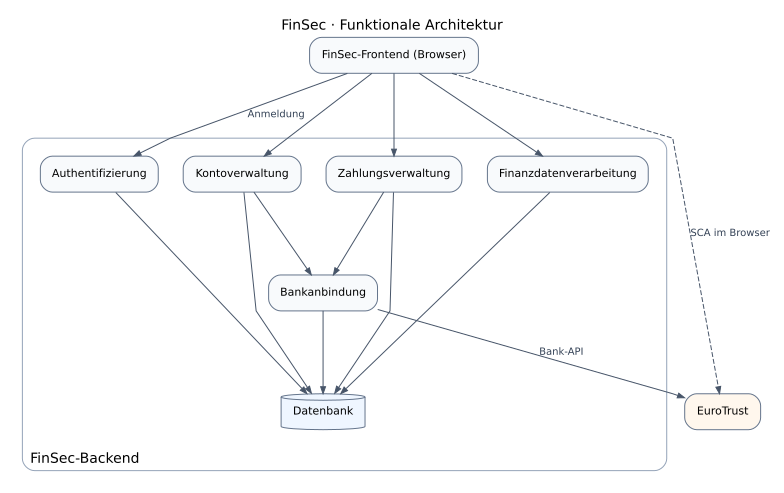
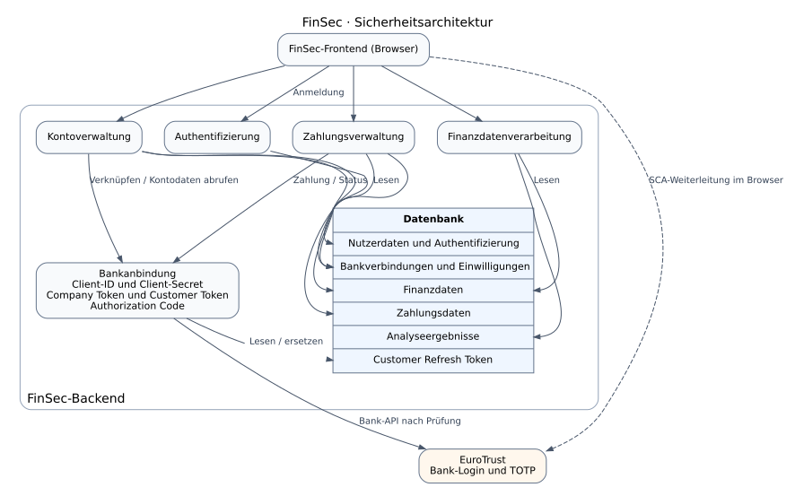

# Design Principles Discussion – FinSec

## Ausgangspunkt und Sicherheitsarchitektur

In der [funktionalen Architektur aus Übung 2, Aufgabe 4](docs/functional%20architecture.md) greifen Authentifizierung, Kontoverwaltung, Zahlungsverwaltung, Finanzdatenverarbeitung und Bankanbindung auf eine gemeinsame Datenbank zu. Das Ausgangsdiagramm weist für diese Zugriffe keine separaten Rechte aus.

### Vorher – funktionale Architektur

Der Browser öffnet die SCA-Seite direkt bei EuroTrust. Für Konto- und Zahlungsoperationen ruft das Backend die Bank-API über die Bankanbindung auf.

### Nachher – Sicherheitsarchitektur

Die durchgezogenen Pfeile zeigen erlaubte Operationen. Der gestrichelte Pfeil zeigt die SCA-Weiterleitung vom Browser zu EuroTrust. Sie führen von der aufrufenden Komponente zur Schnittstelle oder zum Datenbereich, auf den sie zugreifen darf. Die Bereiche im Datenbankkasten gehören zur selben Datenbank.

Die Zugangsmittel stehen bei der zuständigen Komponente oder im zugehörigen Datenbankbereich. Die Tabelle erklärt ihre Speicherdauer. Die Bankanbindung verarbeitet den Authorization Code über die registrierte FinSec-Rückkehr-URL. Den SCA-Ablauf zeigt das [Sequenzdiagramm zur Kontoverknüpfung](docs/user%20account%20link.md).

## 1.1 Zugangsmittel nach EuroTrust-Spezifikation

| Zugangsmittel | Wer braucht es und wofür? | Speicherort und Lebensdauer |
| --- | --- | --- |
| Client-ID und Client-Secret | Die Bankanbindung weist damit FinSec gegenüber dem EuroTrust-Token-Endpunkt aus. Das Paar wird beim Company-Token-Abruf, beim Code-Austausch und beim Refresh verwendet. | Langlebig in serverseitiger Konfiguration mit Zugriff für die Bankanbindung. Das Client-Secret liegt in der geschützten Konfiguration der Bankanbindung und wird nur an den Token-Endpunkt gesendet. |
| Company Token | Die Bankanbindung erstellt damit eine Anfrage zur Kontoverknüpfung bei EuroTrust. | Kurzzeitig im Arbeitsspeicher der Bankanbindung, laut Spezifikation etwa 10 Minuten gültig. |
| Bankzugangsdaten der Kund:innen | Kund:innen geben Bank-Benutzername, Passwort und TOTP auf der EuroTrust-Seite ein. EuroTrust prüft sie. | Die Zugangsdaten bleiben bei Kund:innen und EuroTrust. FinSec speichert sie nicht. |
| Authorization Code | EuroTrust leitet den Browser mit einem einmaligen Code an die registrierte FinSec-Rückkehr-URL weiter. Die Bankanbindung prüft am Rückkehr-Endpunkt die Zuordnung zur Sitzung und zum Vorgang und tauscht den Code anschließend am Token-Endpunkt ein. | Nur während der Verarbeitung im Backend, laut Spezifikation etwa 60 Sekunden gültig. Callback-Parameter werden von der Protokollierung ausgenommen. |
| Customer Refresh Token | Die Bankanbindung fordert damit und mit Client-ID und Client-Secret einen neuen Customer Token an. | Langlebig und verschlüsselt im geschützten Refresh-Token-Bereich der Datenbank, einer konkreten Bankverbindung zugeordnet. Bei erfolgreicher Erneuerung ersetzt der neue Refresh Token den bisherigen. Parallele Erneuerungen derselben Verbindung werden serialisiert. |
| Customer Token | Die Bankanbindung ruft damit Kontodaten zusammen mit der Consent-ID ab und führt die vorgesehenen Zahlungsaufrufe aus. | Kurzzeitig im Arbeitsspeicher der Bankanbindung, laut Spezifikation etwa 30 Minuten gültig. Kontoverwaltung und Zahlungsverwaltung erhalten nur die fachlichen API-Ergebnisse. |

Die Consent-ID gehört zu den Verbindungsdaten. `scaRedirect` führt den Browser zur Bank, und der zufällige `state` ordnet die Rückkehr dem ursprünglichen FinSec-Vorgang zu.

## 1.2 Segmentation and Least Privilege

Die Datenbereiche folgen den Zugriffsrechten der Komponenten. Jede Backend-Komponente verwendet eine eigene Datenbankrolle mit den unten aufgeführten Rechten für die jeweiligen Bereiche. Anfragen von Kund:innen werden zusätzlich auf die eigene Nutzer-ID und die zugeordnete Bankverbindung eingeschränkt.

| Datenbereich | Inhalt und Zugriff |
| --- | --- |
| FinSec-Nutzerdaten | Nutzer-ID, E-Mail und ggf. Profil. Die Authentifizierung verwaltet die Login-Zuordnung. Fachkomponenten erhalten die geprüfte Nutzer-ID. |
| FinSec-Authentifizierung | Passworthashes und Sitzungsdaten. Die Authentifizierung prüft das beim Login eingegebene Passwort und stellt die Sitzung aus. Das Frontend verwendet den Sitzungsnachweis. Die Fachkomponenten prüfen im Backend, ob die Sitzung und die fachliche Berechtigung für den jeweiligen Vorgang vorliegen. |
| Bankverbindungen und Einwilligungen | Nutzer-ID, Bank, Konto- bzw. Ressourcen-ID, Consent-ID und Einwilligungsstatus. Die Kontoverwaltung pflegt die Zuordnung. Die Zahlungsverwaltung liest die benötigte Zuordnung für das Zahlungskonto. Die Bankanbindung erhält die geprüften Verbindungsdaten für den jeweiligen Aufruf. |
| Finanzdaten | Kontostände und Transaktionen. Die Kontoverwaltung liest und schreibt sie. Die Finanzdatenverarbeitung liest nur die für die Auswertung freigegebenen Daten. |
| Zahlungsdaten | Zahlungskonto, Empfänger-IBAN, Betrag, Währung, Zahlungs-ID und Status. Die Zahlungsverwaltung liest und schreibt sie. Die Bankanbindung erhält die Daten, die der konkrete Bankaufruf benötigt. |
| Analyseergebnisse | Klassifikationen, Auswertungen und Sparhinweise. Die Finanzdatenverarbeitung erstellt sie und liefert der Oberfläche nur die Ergebnisse des angemeldeten Nutzers. |
| Bank-API-Zugangsmittel | Die Bankanbindung allein erhält Zugriff auf die TPP-Konfiguration und den Refresh-Token-Bereich der Datenbank. Fachkomponenten rufen bei ihr getrennte Operationen für Kontodaten und Zahlungen auf. EuroTrust erlaubt mit demselben Customer Token beide Arten von Aufrufen. Die Trennung dieser Rechte wird daher innerhalb von FinSec durchgesetzt. |

**Vorteile.** Ein kompromittierter Analysedienst hat über seine Rolle keinen Zugriff auf Refresh Tokens, Passworthashes oder Zahlungsaufträge. Fehler in der Kontoverwaltung eröffnen über deren Schnittstelle keine Zahlungsoperationen.

**Nachteile.** Mehr Dienstrollen und Schnittstellen erhöhen Konfigurations- und Testaufwand. Bei Änderungen an Bankverbindungen oder Token-Rotation müssen Einwilligung, Zuordnung und Token-Speicher konsistent bleiben.

## 1.2 Fail Secure

Die funktionale Architektur sieht Sitzungs- und Berechtigungsprüfungen vor. In der Sicherheitsarchitektur wird ihr Ergebnis zur Voraussetzung für den Bankaufruf. Kontoverwaltung und Zahlungsverwaltung prüfen die gültige Sitzung und Kontozuordnung. Die Bankanbindung prüft die Berechtigung der aufrufenden Komponente für die konkrete Operation. Fehlt eine Voraussetzung oder schlägt die Prüfung fehl, wird die Anfrage abgelehnt.

Vor einer SCA-Weiterleitung bindet FinSec einen zufälligen, kurzlebigen `state` serverseitig an die Sitzung und die konkrete Verknüpfung oder Zahlung. Der Callback prüft diese Bindung und verbraucht den Vorgang einmalig, bevor er den Authorization Code weitergibt. Bei fehlendem, falschem, abgelaufenem oder bereits verwendetem `state` endet der Vorgang ohne Code-Austausch oder Übernahme neuer Tokens. Zahlungen mit unbekanntem Bankstatus bleiben ungeklärt. FinSec fragt bei vorhandener Zahlungs-ID den Status ab und zeigt eine erfolgreiche Zahlung erst nach bestätigtem Bankstatus an. Bei unklarem Ausgang löst FinSec die Zahlung nicht automatisch erneut aus.

**Vorteile.** Eine falsche Callback-Zuordnung kann keine Tokens mit einem anderen FinSec-Konto verknüpfen. Bei einem Timeout verhindert die Statusabfrage, dass FinSec vorschnell Erfolg meldet oder dieselbe Zahlung erneut auslöst.

**Nachteile.** Sind Sitzungsprüfung, Vorgangsspeicher oder Bank zeitweise unerreichbar, können auch berechtigte Vorgänge abgebrochen werden oder ungeklärt bleiben. Abgelaufene Freigaben müssen neu gestartet werden. Für ungeklärte Zahlungen braucht die Oberfläche eine verständliche Statusanzeige.

Grundlagen sind [Übung 3](Aufgabenblätter/Uebung_3_Design_Principles.pdf) und die [EuroTrust-API-Spezifikation, Abschnitte 3 bis 5](Aufgabenblätter/FinSec_Banking_API_for_Students_EN.pdf).
