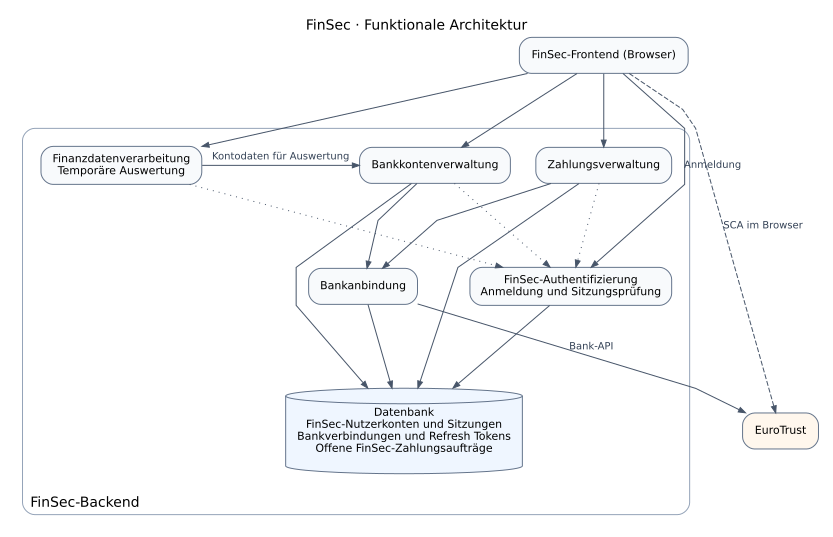

# 2.4 Funktionale Architektur

Die FinSec-Authentifizierung prüft die Anmeldung und stellt eine Sitzung aus. Bei jeder Anfrage an eine Fachfunktion lässt das Backend die Sitzung prüfen. Die gepunkteten Pfeile zeigen diese Prüfungen. Beim Zugriff auf ein Bankkonto prüft die zuständige Fachfunktion zusätzlich die Berechtigung für die Bankverbindung.

Ein **FinSec-Nutzerkonto** ist die Identität für den Login. Eine **Bankverbindung** ordnet diesem Nutzerkonto die Einwilligung und die zugänglichen **Bankkonten** bei der jeweiligen Bank zu. Die Bankkontenverwaltung pflegt diese Zuordnung und ruft Kontodaten über die Bankanbindung ab.

Für eine Auswertung fragt die Finanzdatenverarbeitung bei der Bankkontenverwaltung die Daten für den gewählten Zeitraum an. Die Bankanbindung ruft Kontostände und Transaktionen für die ausgewählten, autorisierten Bankkonten ab. FinSec führt die Daten im Arbeitsspeicher zusammen. Fehlen Daten eines ausgewählten Kontos, kennzeichnet FinSec die Übersicht als unvollständig. Bankkontodaten und Auswertungsergebnisse werden für den aktuellen Abruf verarbeitet.

Die Zahlungsverwaltung hält für offene FinSec-Zahlungsaufträge die Bank-Zahlungs-ID, die Bankverbindung und gegebenenfalls den letzten Status befristet vor. Gebuchte Zahlungen erscheinen über den nächsten Abruf der Banktransaktionen in der Ausgabenübersicht.

Der gestrichelte Pfeil zeigt die SCA-Weiterleitung im Browser. FinSec liefert die Redirect-URL, der Browser öffnet die SCA-Seite der Bank, und Kund:innen melden sich dort an. Die Bank leitet den Browser anschließend an die registrierte FinSec-Rückkehr-URL zurück.

Die [Sicherheitsansicht](3.1-design-principles-discussion.md#nachher--sicherheitsarchitektur) verfeinert diese Architektur. Die [Diagrammübersicht](diagramme/1-3-diagrammuebersicht.md) ordnet die Ansichten und Anwendungsfälle ein.
