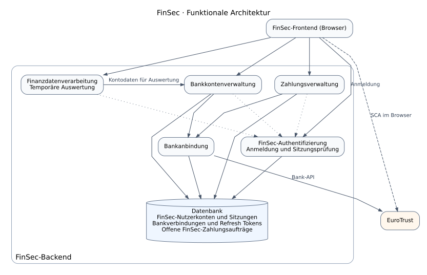
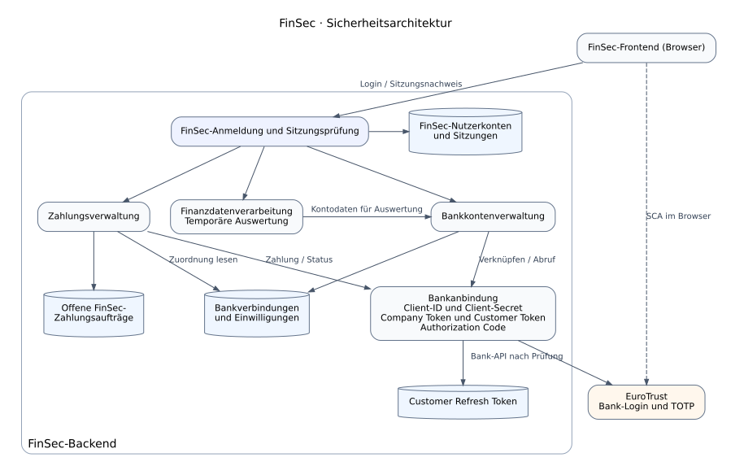

# 3. Design Principles Discussion – FinSec

## 3.1.1 Zuordnung und Speicherung der Zugangsmittel

| Zugangsmittel | Wer braucht es und wofür? | Speicherort und Lebensdauer |
| --- | --- | --- |
| Client-ID und Client-Secret | Die Bankanbindung weist damit FinSec gegenüber dem EuroTrust-Token-Endpunkt aus. Das Paar wird beim Company-Token-Abruf, beim Code-Austausch und beim Refresh verwendet. | Langlebig in serverseitiger Konfiguration mit Zugriff für die Bankanbindung. Das Client-Secret liegt in der geschützten Konfiguration der Bankanbindung und wird nur an den Token-Endpunkt gesendet. |
| Company Token | Die Bankanbindung erstellt damit eine Anfrage zur Kontoverknüpfung bei EuroTrust. | Kurzzeitig im Arbeitsspeicher der Bankanbindung, laut Spezifikation etwa 10 Minuten gültig. |
| Bankzugangsdaten der Kund:innen | Kund:innen geben Bank-Benutzername, Passwort und TOTP auf der EuroTrust-Seite ein. EuroTrust prüft sie. | Die Zugangsdaten bleiben bei Kund:innen und EuroTrust. FinSec speichert sie nicht. |
| Authorization Code | EuroTrust leitet den Browser mit einem einmaligen Code an die registrierte FinSec-Rückkehr-URL weiter. Die Bankanbindung prüft am Rückkehr-Endpunkt die Zuordnung zur Sitzung und zum Vorgang und tauscht den Code anschließend am Token-Endpunkt ein. | Nur während der Verarbeitung im Backend, laut Spezifikation etwa 60 Sekunden gültig. Callback-Parameter werden von der Protokollierung ausgenommen. |
| Customer Refresh Token | Die Bankanbindung fordert damit und mit Client-ID und Client-Secret einen neuen Customer Token an. | Langlebig und verschlüsselt im geschützten Refresh-Token-Bereich der Datenbank, einer konkreten Bankverbindung zugeordnet. Bei erfolgreicher Erneuerung ersetzt der neue Refresh Token den bisherigen. Parallele Erneuerungen derselben Verbindung werden serialisiert. |
| Customer Token | Die Bankanbindung ruft damit Kontodaten zusammen mit der Consent-ID ab und führt die vorgesehenen Zahlungsaufrufe aus. | Kurzzeitig im Arbeitsspeicher der Bankanbindung, laut Spezifikation etwa 30 Minuten gültig. Bankkontenverwaltung und Zahlungsverwaltung erhalten nur die fachlichen API-Ergebnisse. |

Die Consent-ID gehört zu den Verbindungsdaten. `scaRedirect` führt den Browser zur Bank, und der zufällige `state` ordnet die Rückkehr dem ursprünglichen FinSec-Vorgang zu.

## Ausgangspunkt und Sicherheitsarchitektur

Die [funktionale Architektur aus Übung 2, Aufgabe 4](2.4-functional-architecture.md) zeigt die gemeinsame Prüfung der FinSec-Sitzung am Backend-Eingang und die persistenten Speicherbereiche. Die Finanzdatenverarbeitung bezieht Kontodaten über die Bankkontenverwaltung und verarbeitet sie temporär. Die Sicherheitsarchitektur präzisiert die Zugriffsrechte und ordnet die EuroTrust-Zugangsmittel zu.

### Vorher – funktionale Architektur

Der Browser öffnet die SCA-Seite direkt bei EuroTrust. Für Konto- und Zahlungsoperationen ruft das Backend die Bank-API über die Bankanbindung auf.

### Nachher – Sicherheitsarchitektur

FinSec prüft den Sitzungsnachweis zentral und leitet die Anfrage mit der geprüften Nutzeridentität weiter. Der gestrichelte Pfeil zeigt die SCA-Weiterleitung vom Browser zu EuroTrust. Reguläre Kontodatenabrufe führt die Bankanbindung mit einem gültigen Customer Token und der Consent-ID aus. Bei Bedarf erneuert sie den Customer Token serverseitig mit dem Customer Refresh Token.

## 3.1.2 Segmentation and Least Privilege

**Entwurf.** Das Nachher-Diagramm zeigt die persistenten Zugriffsbereiche als separate Zylinder und die eingeschränkten Schnittstellen zur Bankanbindung. Die Segmentierung legt diese Grenzen fest. Die Bereiche können dieselbe physische Datenbank nutzen. Least Privilege bestimmt, welche Rechte jede Komponente innerhalb dieser Grenzen erhält.

**Durchsetzung.** Jede zugreifende Backend-Komponente verwendet eine eigene Datenbankrolle. Die Finanzdatenverarbeitung erhält Kontodaten für die jeweilige Auswertung über die Bankkontenverwaltung. Die Zahlungsverwaltung verwaltet den Status offener FinSec-Zahlungsaufträge. Nur die Bankanbindung greift direkt auf Bankverbindungen und Einwilligungen zu und darf Customer Refresh Tokens lesen und ersetzen. Sie bietet der Bankkontenverwaltung nur Kontooperationen und der Zahlungsverwaltung nur Zahlungsoperationen an. Da EuroTrust mit demselben Customer Token beide Arten von Aufrufen erlaubt, muss FinSec diese Grenze an der eigenen Schnittstelle durchsetzen.

**Sicherheitswirkung und Vorteile.** Wird die Finanzdatenverarbeitung kompromittiert, hat die Komponente keinen direkten Datenbankzugriff auf Refresh Tokens oder offene Zahlungsaufträge. Die Bankkontenverwaltung kann über ihre Schnittstelle bei der Bankanbindung keine Zahlung auslösen. So begrenzen die Rollen und Schnittstellen den Schaden, den ein Fehler in einer Komponente verursachen kann.

**Nachteile.** Getrennte Rollen und Schnittstellen erhöhen den Aufwand für Konfiguration und Berechtigungstests. Die Trennung greift nur, wenn jede Komponente tatsächlich mit ihrer eigenen Identität und ihren eigenen Zugangsdaten arbeitet und nur die Bankanbindung ihre EuroTrust-Zugangsmittel lesen kann.

## 3.1.2 Zero Trust

**Entwurf und Durchsetzung.** Auch interne Aufrufe werden an der empfangenden Schnittstelle geprüft. Der Backend-Eingang prüft die FinSec-Sitzung bei jeder Fachanfrage und übergibt der Fachfunktion die geprüfte Nutzeridentität. Die Bankkontenverwaltung und die Zahlungsverwaltung übergeben die geprüfte Nutzeridentität und bei Zugriffen auf ein bereits verknüpftes Bankkonto dessen interne Referenz. Die Bankanbindung prüft die authentifizierte Dienstidentität, die erlaubte Operation, die Zuordnung des Kontos zur Nutzeridentität und die dafür erforderliche Bankeinwilligung. Das gilt auch für Kontodatenabrufe zur Auswertung. Ein erfolgreicher Aufruf setzt sowohl die fachliche Berechtigung für das Konto als auch die Berechtigung des aufrufenden Dienstes für die Operation voraus. Bei der SCA-Rückkehr prüft die Bankanbindung zudem, ob der kurzlebige `state` zur Sitzung und zum Vorgang gehört und noch unverbraucht ist. Erst danach löst sie den Authorization Code ein. Ein unklarer Zahlungsstatus bleibt bis zur Bestätigung durch EuroTrust offen. Bei vorhandener Zahlungs-ID fragt FinSec den Status ab und löst die Zahlung nicht automatisch erneut aus.

**Sicherheitswirkung und Vorteile.** Ein interner Aufruf erhält seine Berechtigung durch die Prüfungen an der Schnittstelle. So kann beispielsweise ein gültiger Aufruf der Bankkontenverwaltung nur die dafür vorgesehenen Kontooperationen auf einer berechtigten Bankverbindung ausführen. Die Prüfung beim SCA-Rücksprung schützt davor, eine Freigabe dem falschen FinSec-Vorgang zuzuordnen.

**Nachteile.** Dienstidentitäten, Zugriffspolitik und Sitzungsprüfungen müssen gepflegt und getestet werden. Ist eine erforderliche Prüfung vorübergehend nicht möglich, kann auch eine berechtigte Anfrage abgelehnt werden.

Grundlagen sind [Übung 3](aufgabenblaetter/3-design-principles.pdf) und die [EuroTrust-API-Spezifikation, Abschnitte 3 bis 5](aufgabenblaetter/2.3-eurotrust-banking-api.pdf).
