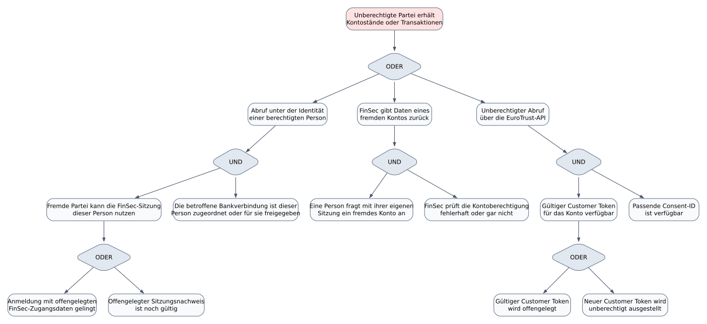

# 4.1.1 Attack Tree – Vertraulichkeit von Kontodaten

> The system shall provide the confidentiality of account information such as balances and transactions.

Die Wurzel beschreibt die Verletzung dieses Schutzziels. Bei **ODER** reicht ein Kindknoten aus. Bei **UND** müssen alle Kindknoten zusammen erfüllt sein.

[JSON-Abgabe](4.1.1-attack%20tree.json) · [DOT-Quelle](diagramme/4.1.1-attack-tree.dot)

## Bezug zur FinSec-Architektur

- **FinSec-Sitzung.** FinSec stellt nach erfolgreicher Anmeldung eine Sitzung aus und prüft ihren Nachweis bei jeder Fachanfrage. Der Baum unterscheidet eine neu ausgestellte Sitzung unter fremder Identität von einem offengelegten, noch akzeptierten Sitzungsnachweis. In beiden Fällen geht es um ein FinSec-Nutzerkonto, das bereits für mindestens ein Bankkonto berechtigt ist. Die Architektur lässt die konkrete Umsetzung des Sitzungsnachweises und die Wahl der Login-Faktoren offen.
- **Kontoberechtigung.** Eine gültige FinSec-Sitzung legitimiert die Person gegenüber FinSec. Bei einem Bankabruf prüft die Bankanbindung zusätzlich, ob das betroffene Bankkonto der geprüften Nutzeridentität zugeordnet oder für sie freigegeben ist. Dieser Ast betrachtet eine fehlerhafte Prüfung bei einer Anfrage aus der eigenen Sitzung.
- **EuroTrust-Zugangsmittel.** Für einen Kontodatenabruf bei EuroTrust gehören ein gültiger Customer Token und die passende Consent-ID zusammen. Die Bankanbindung verwaltet Einwilligungen und Refresh Tokens. Der Company Token dient zum Start der Kontoverknüpfung. Der kurzlebige Authorization Code gehört zum SCA-Rücksprung und wird am Token-Endpunkt eingelöst.
- **Laufende Verarbeitung.** FinSec ruft Kontostände und Transaktionen bei Bedarf ab und verarbeitet sie temporär. Der letzte Ast erfasst die Offenlegung während des Abrufs oder der Auswertung.

[FinSec-Sicherheitsarchitektur](3.1-design-principles-discussion.md#nachher--sicherheitsarchitektur) · [Aufgabenblatt 4](aufgabenblaetter/Uebung_4_Threat_Analysis.pdf)
