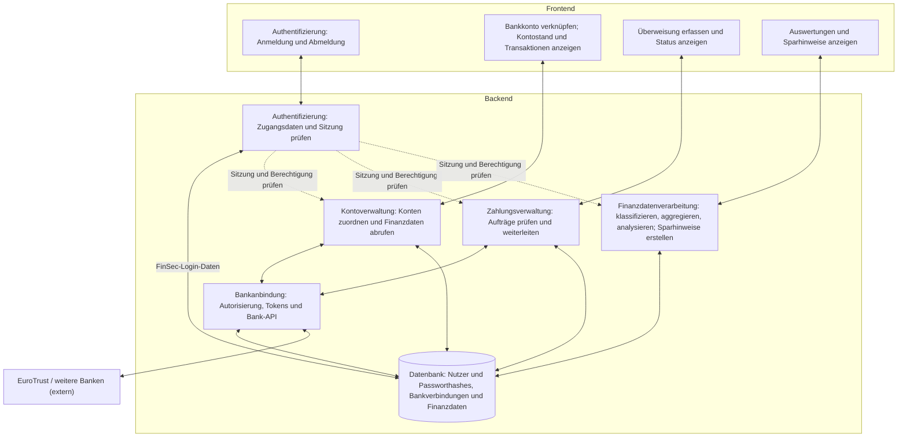

# 2.4 Funktionale Architektur

Die Authentifizierung liegt in beiden Teilen: Das Frontend nimmt die Anmeldung entgegen, das Backend prüft Zugangsdaten und Sitzungen. In der Datenbank werden die FinSec-Nutzerkennung und der Passworthash gespeichert. Die Bankanmeldung erfolgt bei der Bank; FinSec verwaltet dafür die erhaltenen Tokens.
