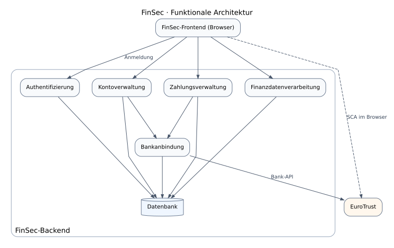

# 2.4 Funktionale Architektur

Das Frontend nutzt Authentifizierung, Kontoverwaltung, Zahlungsverwaltung und Finanzdatenverarbeitung. Die Fachkomponenten prüfen die FinSec-Sitzung und die Berechtigung für den Vorgang. Die Backend-Komponenten greifen auf die gemeinsame Datenbank zu. Konto- und Zahlungsverwaltung nutzen die Bankanbindung für Aufrufe an EuroTrust.

Die gestrichelte Verbindung zeigt die SCA-Weiterleitung im Browser. FinSec liefert die Redirect-URL, der Browser öffnet EuroTrust und Kund:innen melden sich dort bei der Bank an. EuroTrust leitet den Browser anschließend an die registrierte FinSec-Rückkehr-URL zurück.

Die [Sicherheitsansicht](security_view.md) verfeinert diese Architektur. Die [Diagrammübersicht](architecture/README.md) ordnet die Ansichten und Anwendungsfälle ein.
