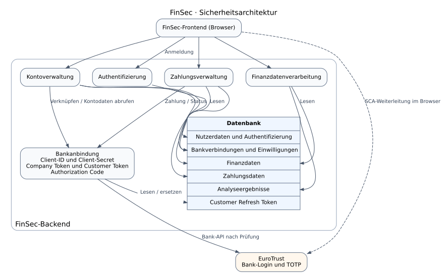

# 3.1.1 Sicherheitsansicht – EuroTrust-Zugangsmittel

Die [funktionale Architektur](functional%20architecture.md) ist der Ausgangspunkt. Die Sicherheitsansicht zeigt, welche Datenbereiche die Backend-Komponenten verwenden. Nur die Bankanbindung greift auf den Customer Refresh Token zu. Sie verwendet die Client-ID, das Client-Secret und die kurzlebigen Tokens für ihre Bank-API-Aufrufe. Konto- und Zahlungsverwaltung rufen jeweils ihre erlaubten Operationen an der Bankanbindung auf.

Die gestrichelte Verbindung zeigt die Weiterleitung des Browsers zur Bank. Bankzugangsdaten und TOTP werden bei EuroTrust eingegeben. Der Rücksprung führt über den Browser zur registrierten FinSec-Rückkehr-URL. Dort prüft die Bankanbindung die Zuordnung zur Sitzung und zum Vorgang, bevor sie den Authorization Code einlöst.

Die [Design Principles Discussion](../design%20principles%20discussion.md) enthält dieselbe Ansicht, die vollständige Tabelle der Zugangsmittel und die Begründung der Zugriffstrennung.
