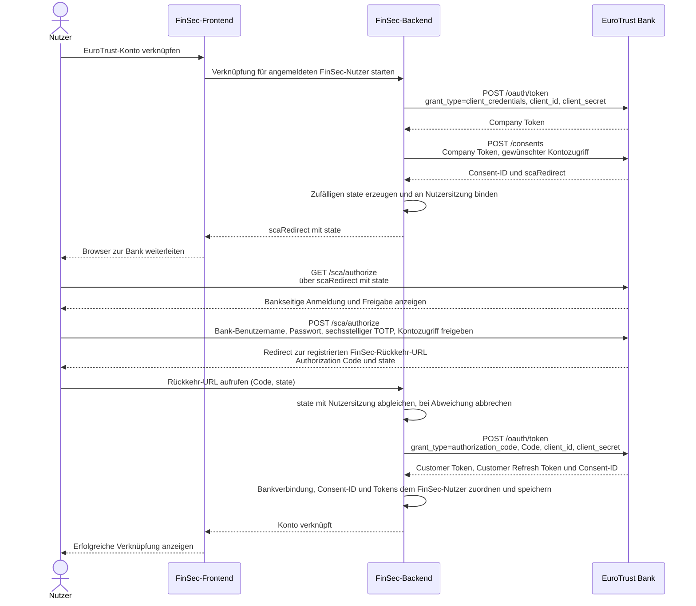

# 2.3 Sequenzdiagramm – Bankkonto verknüpfen

**Voraussetzung:** Der Nutzer ist bei FinSec angemeldet. FinSec besitzt nur die Client-ID und das Client-Secret, noch keine Bank-Tokens.

**Zugangsdaten und Daten:** Client-ID und Client-Secret gehen nur an `/oauth/token`; der Company Token dient zum Anlegen des Consents. Bank-Benutzername, Passwort und TOTP gehen direkt an die Bank. FinSec erhält anschließend die kundenbezogenen Tokens und die Consent-ID. Tokens und Client-Secret bleiben im Backend.

**Quelle:** EuroTrust Bank — API Guide, Abschnitte 3–6. Der Guide nennt keine vollständigen Request-Formate; die Beschriftungen geben die benötigten Informationen an.
