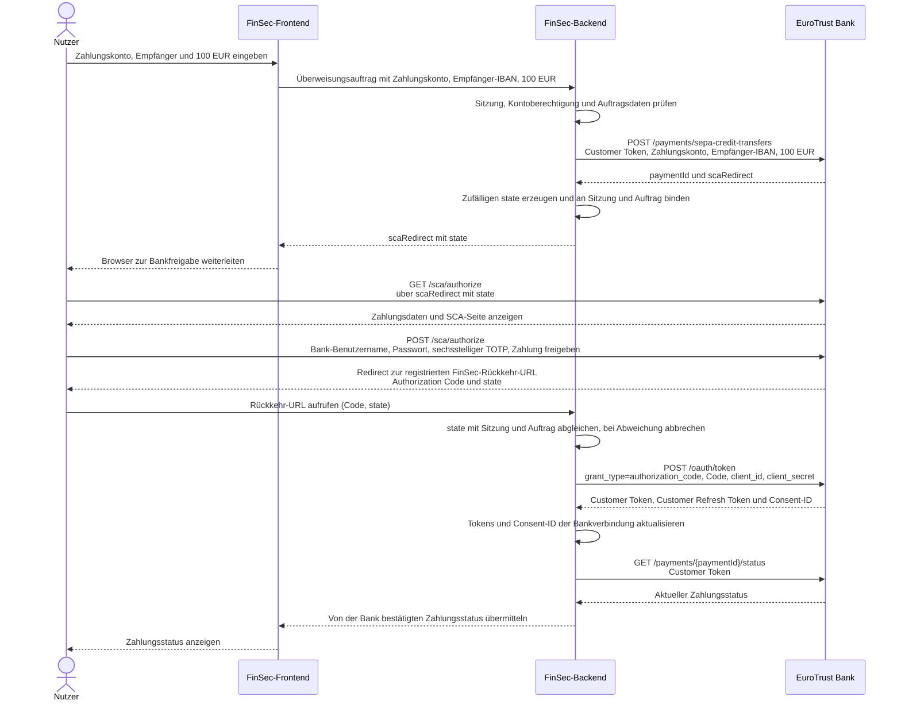

# 2.3 Sequenzdiagramm – 100 € überweisen

**Voraussetzung:** Der Nutzer ist bei FinSec angemeldet und ein gültiger Customer Token ist vorhanden. Die Überweisung benötigt einen SCARedirect zur starken Kundenauthentifizierung bei der Bank.

**Zugangsdaten und Daten:** Der vorhandene Customer Token wird für den Zahlungsauftrag genutzt. Die Zahlung enthält das Zahlungskonto, die Empfänger-IBAN und 100 EUR. Bank-Anmeldedaten und TOTP gehen nur an die Bank. Client-ID und Client-Secret werden nur beim Token-Austausch verwendet; Bank-Tokens bleiben im Backend. FinSec liest den Zahlungsstatus bei der Bank aus, statt die Rückleitung allein als erfolgreiche Zahlung zu behandeln.

**Quelle:** EuroTrust Bank — API Guide, Abschnitte 4–6. Abschnitt 4 beschreibt die Rückkehr mit Code und state sowie den Token-Austausch auch für SCA-pflichtige Zahlungen. Der Ablauf übernimmt diese Schritte. Die Ausnahme für Kleinbeträge unter 30 € greift bei 100 € nicht.
